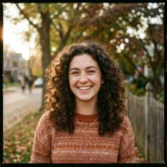
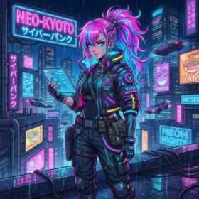

# Clarity AI Studio - Siêu Phục Hồi, Làm Nét & Mở Rộng Khung Hình Ảnh Bằng AI

<p align="center">
  
  
</p>

<p align="center">
  <b>Ứng dụng web AI chuyên sâu phục hồi ảnh mờ, vỡ hạt, nén thấp và đổi tỷ lệ khung hình thông minh (1:1 · 9:16 · 16:9).</b><br>
  Tối ưu hóa phần cứng đồ họa <b>NVIDIA GeForce RTX 3060 (12GB VRAM CUDA - FP16)</b> kết hợp bộ xử lý <b>Intel Core i5-13400F</b>, đồng thời hỗ trợ chế độ tự động chuyển đổi sang CPU khi không có GPU rời.
</p>

---

## 📑 Mục Lục

1. [Tính Năng Chính](#-tính-năng-chính)
2. [Yêu Cầu Hệ Thống](#-yêu-cầu-hệ-thống)
3. [Hướng Dẫn Cài Đặt Môi Trường Từ A - Z](#-hướng-dẫn-cài-đặt-môi-trường-từ-a---z)
4. [Cách Chạy Dự Án](#-cách-chạy-dự-án)
5. [Hướng Dẫn Sử Dụng Chi Tiết](#-hướng-dẫn-sử-dụng-chi-tiết)
6. [Cấu Trúc Thư Mục Dự Án](#-cấu-trúc-thư-mục-dự-án)
7. [Xử Lý Sự Cố Thường Gặp (Troubleshooting)](#-xử-lý-sự-cố-thường-gặp-troubleshooting)
8. [Phím Tắt & Mẹo Hữu Ích](#-phím-tắt--mẹo-hữu-ích)

---

## 🌟 Tính Năng Chính

### 1. 🔍 Siêu Làm Nét & Phục Hồi Chi Tiết (AI Super-Resolution & Batch Enhance)
- **⚡ Làm Nét Hàng Loạt (Batch Multi-Image Enhance)**: Hỗ trợ chọn hoặc kéo thả **nhiều ảnh cùng lúc**, hệ thống tự động xử lý song song trên GPU CUDA, đóng gói toàn bộ thành **1 file ZIP tải về tiện lợi** hoặc **Lưu Thẳng Vào Downloads** của Windows chỉ với 1 click, kèm Gallery xem trước và nút so sánh Before/After cho từng ảnh.
- **🎨 Siêu Nét Vector & Tranh 2D (AnimeSharp ESRGAN)**: Đột phá làm nét tranh vẽ chì, hoạt hình 2D, truyện tranh manga, anime, sticker, logo. Tái tạo đường viền đen đậm nét, sắc sảo, chống hiện tượng mờ nhạt hoặc đứt gãy nét, loại bỏ triệt để vết cắt viền gạch (zero tiling seams) và bảo toàn 100% nền trong suốt (Alpha PNG) không bị lem viền (Hỗ trợ **1X giữ nguyên kích thước**, 2X và 4X).
- **⚡ Siêu Chân Dung (Combo Real-ESRGAN x4plus + GFPGAN v1.4)**: Tái tạo chi tiết mắt, mũi, chân mày, làn da và từng sợi tóc siêu thực cho ảnh chân dung cũ hoặc mờ (1X, 2X, 4X).
- **🖼️ Real-ESRGAN Đa Dụng (x4plus)**: Phục hồi ảnh phong cảnh, công trình kiến trúc, xe cộ, tài liệu, vật thể bị vỡ hạt do nén ảnh (1X, 2X, 4X).
- **🛡️ Siêu Khôi Phục Nhiễu Hạt (SCUNet Swin-Conv-UNet GAN)**: Chuyên trị ảnh chụp thực tế bị hạt muỗi, nhiễu nén JPEG ở tỷ lệ 1X gốc.
- **Tùy chọn phóng to linh hoạt**: Hỗ trợ 1x (Khôi phục nguyên kích thước pixel gốc), 2x hoặc 4x siêu nét, tích hợp bộ lọc làm nét viền thích ứng (Adaptive Crisp Edge Boost).

### 2. 📐 Đổi Tỷ Lệ Khung Hình Thông Minh (Aspect Ratio Studio)
- Hỗ trợ chuyển đổi nhanh giữa 3 tỷ lệ phổ biến nhất:
  - **Vuông 1:1**: Instagram, Avatar, sàn TMĐT (Shopee, Lazada).
  - **Dọc 9:16**: TikTok, Facebook Reels, YouTube Shorts, Instagram Story.
  - **Ngang 16:9**: YouTube Video, màn hình máy tính, TV, banner.
- **5 Cơ chế chuyển đổi hiện đại**:
  - **AI Generative Outpaint (LaMa Neural Network)**: Mạng nơ-ron tự vẽ bù và mở rộng không gian xung quanh một cách tự nhiên mà **không cắt xén chủ thể**.
  - **Smart Center Crop**: Cắt tràn viền thông minh giữ trung tâm chủ thể.
  - **Ambient Blur Expand**: Mở rộng ảnh bằng nền mờ chiều sâu studio kèm bóng đổ (Drop Shadow).
  - **Fit & Pad viền sạch**: Thêm viền màu đen, trắng hoặc màu chủ đạo tự động.
  - **Stretch**: Co giãn tỷ lệ theo yêu cầu.
- **Xử lý liên hoàn**: Làm nét xong có thể bấm ngay nút *"Dùng ảnh vừa làm nét"* để chuyển sang đổi tỷ lệ khung hình mà không cần tải lại file.

### 3. 📦 Resize Hàng Loạt Sang PNG & Tải Về File ZIP (Batch Resize Studio)
- **Tải lên cùng lúc nhiều ảnh**: Kéo thả hàng chục ảnh, chọn nhiều file cùng lúc hoặc dán trực tiếp từ Clipboard (`Ctrl + V`).
- **Tùy chỉnh kích thước tự do (Width x Height)**: Tùy ý nhập kích thước pixel bất kỳ, hỗ trợ nút đảo chiều nhanh (Rộng ⇄ Cao) và các kích thước chuẩn gợi ý sẵn (1080x1080, 1080x1920, 1920x1080, 512x512, 1440x1080, 820x312).
- **Tuyệt đối KHÔNG VIỀN ĐEN**: Cơ chế **Giãn vừa khít (Stretch)** co giãn ảnh khớp 100% kích thước mới (chấp nhận méo nhẹ nếu khác tỷ lệ gốc để không xuất hiện viền đen), hoặc tùy chọn **Cắt giữa tràn viền (Center Crop)** không viền đen và không méo.
- **Chuẩn hóa 100% định dạng PNG**: Toàn bộ ảnh xuất xưởng đều được chuyển đổi sang định dạng PNG chất lượng cao, giữ màu sắc trung thực.
- **Đóng gói tải về 1-Click File ZIP**: Tự động gom toàn bộ ảnh đã xử lý thành 1 tệp `.zip` duy nhất; hỗ trợ tải trực tiếp về máy hoặc lưu thẳng vào thư mục `Downloads` của Windows. Ngoài ra có thể xem gallery và tải lẻ từng ảnh.

### 4. 🗜️ Nén Dung Lượng Tối Ưu Theo Mức MB (100% Giữ Nguyên Kích Thước & Tên Ảnh)
- **Kiểm soát dung lượng chính xác**: Người dùng nhập mức dung lượng mục tiêu mong muốn tính theo Megabyte (MB) (ví dụ: `0.5 MB`, `1.0 MB`, `2.0 MB`...). Hệ thống đảm bảo file đầu ra luôn `<= mức MB mục tiêu`.
- **100% GIỮ NGUYÊN KÍCH THƯỚC GỐC (No Downscaling)**: Tuyệt đối không co nhỏ hoặc làm biến dạng pixel, bảo toàn 100% chiều rộng và chiều cao nguyên bản (Width x Height) của từng bức ảnh.
- **GIỮ NGUYÊN TÊN ẢNH GỐC**: Toàn bộ tệp ảnh sau khi nén đều giữ nguyên tên tệp ban đầu của bạn, kết hợp với phần mở rộng định dạng tương ứng (`.png`, `.jpg`, `.webp`).
- **Hỗ trợ Nén Hàng Loạt (Batch Compress)**: Tải lên hàng chục ảnh cùng lúc (kéo thả, chọn tệp hoặc nhấn `Ctrl + V`). Nén đồng loạt và tải về trọn bộ bằng **1 file ZIP** hoặc lưu trực tiếp file ZIP vào thư mục `Downloads` của máy.
- **Đa dạng 3 định dạng xuất linh hoạt**:
  - **WebP (Khuyên dùng)**: Nén siêu nét, giữ trọn vẹn chi tiết và màu sắc mà không bị vỡ hạt.
  - **JPG (Chroma 4:4:4)**: Khóa phổ màu đầy đủ 4:4:4, chống loang màu viền chữ và tương thích tuyệt đối mọi thiết bị.
  - **PNG (Trong Suốt - Giữ Alpha)**: Bảo toàn nền trong suốt hoàn hảo, ứng dụng lượng tử hóa màu thích ứng giữ nguyên 100% độ phân giải.
- **Tuyệt đối KHÔNG LOANG MÀU (Chroma 4:4:4)**: Khắc phục triệt để hiện tượng nhòe màu, lem màu ở các ranh giới tương phản cao.
- **Thanh trượt so sánh Before/After & Gallery tải lẻ**: Cung cấp thanh trượt Before/After trực quan cho chế độ 1 ảnh và Gallery chuyên nghiệp cho chế độ hàng loạt (hỗ trợ nút **Tải Lẻ** và **Lưu Downloads** cho từng bức ảnh).

### 5. 🎨 Tạo Ảnh Bằng AI (Text-to-Image & Image-to-Image Studio)
- **Tạo ảnh từ văn bản (Text-to-Image - T2I)**: Mô tả bất kỳ ý tưởng nào bằng tiếng Việt hoặc tiếng Anh, AI sẽ biến thành tác phẩm nghệ thuật chỉ trong **2–3 giây** trên GPU NVIDIA RTX 3060 (12GB VRAM CUDA).
- **Biến đổi ảnh có sẵn (Image-to-Image - I2I)**: Tải ảnh chân dung, ảnh mẫu hoặc phác thảo lên kèm prompt để biến hóa phong cách mới mà vẫn bảo toàn tỷ lệ và đường nét chính (tùy chỉnh thanh trượt Denoising Strength từ 0.1 đến 0.95).
- **Bộ 8 phong cách nghệ thuật tinh chọn (Style Presets)**:
  - 🎬 **Điện Ảnh 8K (Cinematic Movie)**: Ánh sáng kịch tính, ống kính 35mm, góc quay điện ảnh Hollywood.
  - 📸 **Nhiếp Ảnh Đời Thực (Photorealistic DSLR)**: Chi tiết da chân thực, khẩu độ f/1.8 xóa phông chuẩn studio.
  - 🌸 **Anime Makoto Shinkai (Hoạt Hình 2D)**: Màu sắc rực rỡ, bầu trời lung linh phong cách Nhật Bản.
  - 🌃 **Cyberpunk Neon (Khoa Học Viễn Tưởng)**: Ánh sáng neon tím/cyan, phố xá tương lai ngập sương mờ.
  - 🧸 **3D Hoạt Hình Pixar / Disney**: Nhân vật 3D đáng yêu, bề mặt mịn màng, ánh sáng ấm áp.
  - 🏰 **Thần Thoại & Giả Tưởng (Epic Fantasy)**: Lâu đài bay, sinh vật kỳ bí, chất họa Digital Painting đỉnh cao.
  - 🎞️ **Phim Cổ Điển Retro (Vintage 1970s)**: Tông màu ấm hoài niệm, hạt phim analog nghệ thuật.
- **Tùy biến tỷ lệ khung hình linh hoạt**:
  - `🟦 1:1 Vuông (512x512)`: Chuẩn mạng xã hội, avatar, tranh vuông.
  - `📱 9:16 Dọc (512x896)`: Chuẩn video dọc TikTok, Reels, Shorts, Story.
  - `💻 16:9 Ngang (896x512)`: Chuẩn màn hình máy tính, YouTube video, wallpaper.
  - `📺 4:3 Cổ Điển (640x480)`: Chuẩn khung ảnh truyền thống.
- **Đa dạng mô hình AI & Caching tự động**:
  - `⚡ Stable Diffusion v1.5`: Có sẵn cục bộ trên máy, tốc độ sinh ảnh cực nhanh ~2.5 giây.
  - `🎨 DreamShaper v8`: Tranh 3D & concept nghệ thuật.
  - `📸 Realistic Vision v5.1`: Nhiếp ảnh và chân dung siêu nét.
  - `🌌 Openjourney v4`: Phong cách nghệ thuật Midjourney.
- **Quy trình làm việc liên hoàn (Seamless Multi-tab Workflow)**:
  - Tạo ảnh xong có thể bấm ngay nút **"🔍 Chuyển Sang Siêu Làm Nét"** để upscale ảnh lên 2x / 4x 4K sắc nét tuyệt đỉnh.
  - Hoặc bấm **"📐 Chuyển Sang Đổi Tỷ Lệ"** để outpaint mở rộng khung hình.
  - Hoặc bấm **"🗜️ Chuyển Sang Nén Dung Lượng"** để nén file theo mức MB mục tiêu.
  - Hoặc bấm **"🔄 Dùng Làm Ảnh Nguồn I2I Tiếp"** để tiếp tục tinh chỉnh sáng tạo theo vòng lặp.

### 6. 🤖 Trợ Lý AI, Chatbot Cố Vấn & Biến Ảnh Thành Prompt (Local LLM Hub)
- **Tối ưu Prompt AI từ Ngôn Ngữ Tự Nhiên**: Nhập ý tưởng bằng tiếng Việt hoặc tiếng Anh (ví dụ: *"cô gái mặc áo dài trắng dạo bước hồ gươm chiều thu"*), AI sẽ tự động phân tích và chuyển đổi thành Prompt chuyên nghiệp chuẩn 8K UHD cho Stable Diffusion / Midjourney kèm cấu trúc ống kính và Negative Prompt tối ưu.
- **Biến Ảnh Thành Prompt (Image-to-Prompt Reverse Engineering)**: Tải lên hoặc dán ảnh bất kỳ, AI sử dụng Computer Vision để bóc tách:
  - Tỷ lệ khung hình & độ phân giải pixel gốc.
  - Bảng mã màu chủ đạo (K-Means Dominant HEX Colors & tỷ lệ phần trăm %).
  - Nhiệt độ màu (Tông ấm, tông lạnh, cân bằng).
  - Ánh sáng & tương phản (High-key, low-key, studio diffused).
  - Prompt chuẩn xác giúp tái tạo lại không gian và màu sắc bức ảnh.
- **1-Click Chuyển Thẳng Sang Studio Tạo Ảnh**: Bấm nút *"Sử Dụng Cho Tạo Ảnh (T2I)"* hoặc *"Chuyển Sang Image-to-Image"* để tự động chuyển prompt và ảnh sang Studio Tạo Ảnh AI.
- **Chatbot Cố Vấn Nhiếp Ảnh & Màu Sắc**: Hỏi đáp về lý thuyết phối màu Cyberpunk, Vintage, bảng màu Pastel, kỹ thuật chụp chân dung 85mm f/1.4 xóa phông mượt mà, và mẹo phục hồi chi tiết.
- **Local Model Hub Đa Nền Tảng (100% Free & Offline)**:
  - ⚡ **Clarity Local Engine**: Tích hợp sẵn 100% offline, phản hồi siêu tốc 0.05s, 0% tốn thêm VRAM.
  - 🤖 **Qwen 2.5 Instruct Local GPU**: Chạy trực tiếp trên 12GB VRAM card đồ họa RTX 3060 qua CUDA.
  - 🦙 **Ollama Local Hub**: Kết nối linh hoạt tới Ollama chạy cục bộ (`localhost:11434` - Llama 3.2, Qwen 2.5, Llava).
  - 🖥️ **LM Studio / Local OpenAI API**: Tương thích chuẩn OpenAI chạy qua cổng `localhost:1234`.

### 7. 🎨 Trải Nghiệm Giao Diện Người Dùng Đỉnh Cao (Dark Glassmorphism)
- **Thanh trượt so sánh tương tác (Interactive Split Slider)**: Kéo qua lại trực tiếp trên ảnh để so sánh chất lượng Trước/Sau.
- **Nhiều chế độ quan sát**: Kéo thanh trượt, Đặt cạnh nhau (Side-by-Side), Phóng to chi tiết (Zoom 180%), Xem riêng ảnh gốc hoặc ảnh xử lý.
- **Thao tác tải ảnh cực nhanh**: Kéo & thả tệp, chọn từ máy tính, hoặc **dán ảnh trực tiếp từ Clipboard (`Ctrl + V`)**.
- **Lưu ảnh linh hoạt**: Tải PNG/JPG/WebP chất lượng cao, hoặc bấm **"Lưu Thẳng Vào Downloads"** của Windows chỉ với 1 click.

---


## 💻 Yêu Cầu Hệ Thống

| Thành Phần | Khuyến Nghị (Tốt Nhất) | Tối Thiểu |
| :--- | :--- | :--- |
| **Hệ Điều Hành** | Windows 10 / 11 (64-bit) | Windows 10 / Linux / macOS |
| **Python** | **Python 3.10 hoặc 3.11** (Đã kiểm tra 3.11.7) | Python 3.9+ |
| **GPU (Card đồ họa)** | NVIDIA RTX 3060 (12GB VRAM) hoặc dòng RTX 30/40 series | Hỗ trợ chạy trên CPU (tốc độ chậm hơn) |
| **CUDA** | CUDA 12.1 hoặc 11.8 (kèm PyTorch cu121) | Không bắt buộc nếu chạy CPU |
| **RAM** | 16GB trở lên | 8GB |
| **Ổ cứng trống** | Khoảng 3GB - 5GB (chứa mã nguồn và trọng số model AI) | 2GB |

---

## 🛠️ Hướng Dẫn Cài Đặt Môi Trường Từ A - Z

Nếu bạn mới tải dự án về máy tính lần đầu, hãy thực hiện theo các bước sau để thiết lập môi trường:

### Bước 1: Mở Terminal tại thư mục dự án
Mở **Command Prompt (cmd)** hoặc **PowerShell**, chuyển vào thư mục dự án:
```powershell
cd "c:\Users\Admin\.gemini\antigravity-ide\scratch\ai-photo-enhancer"
```

### Bước 2: Tạo môi trường ảo Python (Khuyên Dùng)
Tạo môi trường ảo để không ảnh hưởng đến các thư viện Python khác trong máy:
```powershell
python -m venv venv
```

Kích hoạt môi trường ảo:
- Trên **Windows (Command Prompt)**:
  ```cmd
  venv\Scripts\activate.bat
  ```
- Trên **Windows (PowerShell)**:
  ```powershell
  venv\Scripts\Activate.ps1
  ```
*(Sau khi kích hoạt, bạn sẽ thấy tiền tố `(venv)` xuất hiện ở đầu dòng lệnh).*

### Bước 3: Cài đặt PyTorch hỗ trợ GPU CUDA
Để tận dụng tối đa sức mạnh của card đồ họa NVIDIA (RTX 3060, v.v.), hãy cài đặt PyTorch phiên bản CUDA:

- **Dành cho máy có GPU NVIDIA (CUDA 12.1 - Khuyên dùng):**
  ```powershell
  pip install torch torchvision --index-url https://download.pytorch.org/whl/cu121
  ```

- **Dành cho máy chỉ dùng CPU (không có GPU rời):**
  ```powershell
  pip install torch torchvision
  ```

### Bước 4: Cài đặt các thư viện cần thiết trong `requirements.txt`
Chạy lệnh sau để cài đặt toàn bộ thư viện backend và xử lý ảnh:
```powershell
pip install -r requirements.txt
```

> [!NOTE]
> Danh sách thư viện chính bao gồm:
> - `realesrgan>=0.3.0` & `basicsr>=1.4.2`: Xử lý siêu phân giải và tăng độ nét.
> - `gfpgan>=1.3.8` & `facexlib>=0.3.0`: Nhận diện khuôn mặt và phục hồi chi tiết mắt, mũi, miệng.
> - `Flask>=3.0.0`: Máy chủ web backend API.
> - `opencv-python>=4.8.0`, `Pillow>=10.0.0`, `numpy`: Xử lý ma trận ảnh và màu sắc.

### Bước 5: Tải trọng số mô hình AI vào thư mục `models/`
Bạn có thể tự động tải toàn bộ trọng số mô hình chỉ với **1 lệnh duy nhất**:
```powershell
python download_models.py
```

Hoặc tải thủ công và đặt vào đúng vị trí:
```
ai-photo-enhancer/
├── models/
│   ├── RealESRGAN_x4plus.pth           # (~67 MB)
│   ├── RealESRGAN_x4plus_anime_6B.pth  # (~18 MB)
│   ├── GFPGANv1.4.pth                  # (~348 MB)
│   └── big-lama.pt                     # (~205 MB - AI outpainting đổi tỷ lệ)
```

---

## 🚀 Cách Chạy Dự Án

### Cách 1: Khởi động 1-Click bằng file `run.bat` (Cực Nhanh & Tiện)
Trong thư mục dự án, bạn chỉ cần **nhấp đúp chuột (Double Click)** vào tệp:
```
run.bat
```
Cửa sổ terminal sẽ hiện lên thông báo khởi động máy chủ Flask và cấu hình GPU.

---

### Cách 2: Khởi động bằng dòng lệnh (Terminal / PowerShell / CMD)
Mở cửa sổ dòng lệnh tại thư mục dự án và chạy:

```powershell
# 1. Kích hoạt môi trường ảo (nếu có sử dụng venv)
venv\Scripts\activate

# 2. Khởi chạy máy chủ
python server.py
```

Khi chạy thành công, terminal sẽ hiển thị:
```text
[Server] Initializing AI Engines...
[Enhancer] Initialized on device: CUDA (FP16: True)
[AspectConverter] Loading LaMa Outpaint model on cuda...
[Server] AI Engines ready!

=======================================================
  AI Photo Clarity Studio Server Started!
  URL: http://127.0.0.1:7860
  GPU Acceleration: Active
=======================================================
```

Bây giờ bạn chỉ cần mở trình duyệt web (Chrome, Edge, Cốc Cốc, Brave, Firefox) và truy cập:
👉 **[http://127.0.0.1:7860](http://127.0.0.1:7860)**

---

### Cách 3: Cho phép thiết bị khác trong mạng nội bộ (WiFi / LAN) truy cập
Nếu bạn muốn dùng điện thoại, máy tính bảng hoặc laptop khác trong cùng mạng WiFi để làm nét ảnh:

1. Mở tệp `server.py` bằng trình soạn thảo văn bản.
2. Tìm dòng cuối cùng (dòng 412):
   ```python
   app.run(host='127.0.0.1', port=port, debug=False)
   ```
3. Đổi thành:
   ```python
   app.run(host='0.0.0.0', port=port, debug=False)
   ```
4. Kiểm tra địa chỉ IPv4 của máy tính (bằng lệnh `ipconfig`), ví dụ: `192.168.1.15`.
5. Trên điện thoại/iPad mở trình duyệt vào: `http://192.168.1.15:7860`.

---

## 📖 Hướng Dẫn Sử Dụng Chi Tiết

Giao diện ứng dụng gồm 2 tab chính ở thanh điều hướng trên cùng:

### 🌟 Tab 1: "Siêu Làm Nét AI" (Super-Resolution)
1. **Bước 1 - Tải ảnh lên**:
   - Kéo thả ảnh từ thư mục vào ô tải lên.
   - Hoặc click vào ô để chọn tệp từ máy tính.
   - Hoặc sao chép ảnh từ web/ảnh chụp màn hình và nhấn **`Ctrl + V`** để dán ngay lập tức.
   - Bạn cũng có thể bấm vào các nút ảnh mẫu (*Chân dung cũ*, *Anime 2D*) để trải nghiệm nhanh.
2. **Bước 2 - Chọn mô hình & thông số**:
   - **Siêu Khôi Phục 1X (SCUNet Swin-Conv-UNet GAN)**: Lựa chọn hàng đầu cho **ảnh vỡ hạt nặng, nhiễu nén JPEG, ảnh mờ vỡ điểm ảnh**. Giữ nguyên 100% kích thước pixel gốc (1x), không làm tăng kích thước ảnh.
   - **Siêu Chân Dung (Real-ESRGAN + GFPGAN)**: Phù hợp nhất cho ảnh có người, ảnh thẻ, ảnh gia đình, ảnh chân dung cổ điển (phóng đại 2x / 4x).
   - **Real-ESRGAN Đa Dụng**: Phù hợp cho phong cảnh, chữ viết, đồ vật, kiến trúc (2x / 4x).
   - **Siêu Nét Vector & AnimeSharp**: Phù hợp cho hình vẽ 2D, truyện tranh, hoạt hình, tranh nét chì, sticker, logo (tái tạo nét viền đen đậm sắc, không bị mờ đứt, 1x / 2x / 4x).
   - Chọn độ phóng đại: `1x` (Tự động khi chọn SCUNet), `2x` hoặc `4x`.
   - Tùy chọn `Phục hồi chi tiết khuôn mặt (GFPGAN)`: Tích chọn để AI tập trung làm nét mắt, mũi, miệng (hỗ trợ cả ở 1x lẫn 2x/4x).
3. **Bước 3 - Xử lý & Xem kết quả**:
   - Bấm nút **"Bắt Đầu Khôi Phục & Làm Nét"**.
   - Sau vài giây, kết quả sẽ hiện lên. Bạn kéo thanh trượt giữa ảnh để xem sự biến đổi kinh ngạc trước và sau khi làm nét.
   - Nhấn các nút chế độ xem: `Thanh Trượt`, `Cạnh Nhau`, `Phóng To 180%` để kiểm tra từng sợi tóc, nếp da.
4. **Bước 4 - Tải ảnh về**:
   - Bấm **"Tải PNG (Gốc)"** để tải ảnh nguyên bản không nén.
   - Bấm **"Tải JPG"** để tải phiên bản JPG nhỏ gọn (chất lượng 95%).
   - Bấm **"Lưu Thẳng Vào Downloads"** để hệ thống tự động copy thẳng vào thư mục `Downloads` của Windows.

---

### 📐 Tab 2: "Đổi Tỷ Lệ Ảnh (1:1 · 9:16 · 16:9)"
1. **Bước 1 - Chọn ảnh**:
   - Tải ảnh mới lên, hoặc bấm nút **"Dùng ảnh vừa làm nét"** để lấy trực tiếp thành phẩm ở Tab 1 sang đổi tỷ lệ.
2. **Bước 2 - Chọn tỷ lệ đích**:
   - `Vuông 1:1`: Phù hợp đăng bài feed Instagram, avatar, ảnh sản phẩm.
   - `Dọc 9:16`: Tối ưu hóa làm video TikTok, Reels, Shorts, Story.
   - `Ngang 16:9`: Tối ưu cho video YouTube, màn hình máy tính, trình chiếu.
3. **Bước 3 - Chọn chế độ chuyển đổi**:
   - **AI Sinh Không Gian (Generative Outpaint - Khuyên dùng)**: AI sử dụng mô hình LaMa để vẽ mở rộng thêm khung cảnh bên trái/phải hoặc trên/dưới mà vẫn giữ 100% chủ thể gốc nguyên vẹn.
   - **Cắt Tràn Viền (Smart Crop)**: Phóng to và cắt tỉ lệ cân đối ở trung tâm.
   - **Làm Mờ Nền (Ambient Blur)**: Tạo phông nền mờ ảo phía sau tạo cảm giác chuyên nghiệp.
   - **Thêm Viền Màu (Fit & Pad)**: Giữ nguyên ảnh và đệm thêm viền đen/trắng.
4. **Bước 4 - Tùy chọn bổ sung & Xuất ảnh**:
   - Chọn vị trí căn chỉnh (`Giữa`, `Trên`, `Dưới`, `Trái`, `Phải`).
   - Tích chọn `Kết hợp làm nét AI sau khi đổi tỷ lệ` nếu muốn ảnh sau khi mở rộng đạt độ phân giải siêu cao.
   - Bấm **"Bắt Đầu Đổi Tỷ Lệ Ảnh"** và tải kết quả về máy.

---

### 📦 Tab 3: "Resize Hàng Loạt (Batch PNG)"
1. **Bước 1 - Tải nhiều ảnh cùng lúc**:
   - Chọn cùng lúc nhiều ảnh từ máy tính (giữ phím `Ctrl` hoặc `Shift` khi chọn tệp).
   - Kéo & thả cùng lúc hàng chục tệp ảnh vào ô tải lên.
   - Nhấn **`Ctrl + V`** để dán ảnh chụp màn hình trực tiếp từ Clipboard.
   - Danh sách ảnh đã chọn sẽ hiển thị trực quan kèm số lượng, dung lượng và nút xóa từng ảnh hoặc xóa tất cả.
2. **Bước 2 - Nhập kích thước & Tùy chọn**:
   - Nhập **Chiều Rộng (Width)** và **Chiều Cao (Height)** theo pixel (ví dụ: `1080 x 1080`, `1920 x 1080`...).
   - Bấm các nút kích thước chuẩn gợi ý nhanh (`1:1 Vuông`, `9:16 TikTok`, `16:9 Full HD`, `Avatar 512x512`...).
   - Bấm nút hoán đổi **Rộng ⇄ Cao** nếu cần đảo hướng ảnh nhanh.
   - Chọn cơ chế khớp khung:
     - **Giãn vừa khít (Stretch - Mặc định)**: 100% vừa khít kích thước mới, **tuyệt đối không có viền đen** (có thể méo ảnh để vừa khung).
     - **Cắt giữa tràn viền (Center Crop)**: Không viền đen, giữ nguyên tỉ lệ không méo.
3. **Bước 3 - Tiến hành Resize**:
   - Bấm nút **"Bắt Đầu Resize Hàng Loạt (X ảnh)"**.
   - Hệ thống xử lý siêu tốc qua thuật toán nội suy Lanczos-4, chuyển đổi 100% ảnh sang chuẩn `.png`.
4. **Bước 4 - Tải về kết quả**:
   - Bấm nút lớn **"📦 Tải Về Trọn Bộ (File ZIP)"** để tải 1 file `.zip` nén toàn bộ ảnh kết quả.
   - Bấm **"💾 Lưu ZIP Vào Downloads"** để lưu trực tiếp vào thư mục Downloads của Windows.
   - Khung Gallery bên dưới hiển thị ảnh xem trước, độ phân giải cũ ➔ mới, dung lượng và 2 nút tiện lợi cho từng ảnh:
     - **📥 Tải PNG**: Tải tệp PNG chuẩn trực tiếp qua trình duyệt.
     - **💾 Lưu Downloads**: Lưu trực tiếp tệp ảnh vào thư mục `Downloads` của Windows (`C:\Users\...\Downloads`).

---

### 🗜️ Tab 4: "Nén Dung Lượng (Target MB)"
1. **Bước 1 - Chọn một hoặc nhiều ảnh cần nén**:
   - Tải lên 1 hoặc hàng loạt nhiều ảnh cùng lúc (kéo thả, chọn nhiều tệp hoặc nhấn **`Ctrl + V`** để dán ảnh trực tiếp).
   - Hoặc bấm nút **"Dùng ảnh vừa xử lý"** / chọn các ảnh mẫu.
   - Khi chọn nhiều ảnh, danh sách ảnh hiển thị số lượng, kích thước từng ảnh và nút xóa linh hoạt.
2. **Bước 2 - Đặt mức dung lượng mục tiêu (Target MB)**:
   - Nhập số dung lượng tối đa mong muốn (ví dụ: `1.0` MB, `0.5` MB, `2.0` MB...).
   - Bấm các nút gợi ý nhanh: `0.3 MB (Web/Email)`, `0.5 MB (Zalo)`, `1.0 MB (Chuẩn Web/Shopee)`, `2.0 MB (Facebook)`...
   - Chọn định dạng: **WebP (Khuyên dùng - Nén siêu nét)**, **JPG (Chroma 4:4:4 - Chống loang màu)**, hoặc **PNG (Trong Suốt - Giữ kênh Alpha)**.
   - Hệ thống cam kết **100% giữ nguyên kích thước gốc (Width x Height)** và **giữ nguyên tên tệp ban đầu**.
3. **Bước 3 - Tiến hành nén**:
   - Bấm nút **"Bắt Đầu Nén Xuống X MB"** (hoặc **"Bắt Đầu Nén Hàng Loạt (N ảnh)..."**).
   - Thuật toán lượng tử hóa chất lượng thông minh tự động tối ưu hóa dữ liệu để đạt chuẩn `<= Target MB` mà không làm thay đổi kích thước pixel.
4. **Bước 4 - Tải về kết quả**:
   - **Chế độ 1 ảnh**: Xem thanh trượt so sánh Before/After trực tiếp, bấm **"Tải Ảnh Đã Nén"** hoặc **"Lưu Thẳng Vào Downloads"**.
   - **Chế độ hàng loạt**:
     - Bấm **"📦 Tải Về Trọn Bộ (File ZIP)"** để tải về 1 tệp nén chứa toàn bộ ảnh với tên gốc.
     - Bấm **"💾 Lưu ZIP Vào Downloads"** để lưu trực tiếp tệp ZIP vào thư mục `Downloads` của máy.
     - Xem danh sách ảnh kết quả trong Gallery và tải lẻ hoặc lưu vào Downloads từng ảnh riêng biệt.

---

## 📁 Cấu Trúc Thư Mục Dự Án

```
ai-photo-enhancer/
│
├── models/                                # Thư mục chứa các mô hình trọng số AI
│   ├── scunet_color_real_gan.pth          # Model SCUNet phục hồi 1X không đổi kích thước
│   ├── RealESRGAN_x4plus.pth              # Model x4 cho ảnh thực tế
│   ├── RealESRGAN_x4plus_anime_6B.pth     # Model x4 cho tranh vẽ Anime
│   ├── GFPGANv1.4.pth                     # Model phục hồi khuôn mặt
│   └── big-lama.pt                        # Model LaMa Neural Outpainting mở rộng khung hình
│
├── gfpgan/                                # Cấu hình và trọng số phụ trợ GFPGAN
│   └── weights/
│       ├── detection_Resnet50_Final.pth   # Model nhận diện khuôn mặt
│       └── parsing_parsenet.pth           # Model phân tích các bộ phận khuôn mặt
│
├── static/                                # Tài nguyên tĩnh Web Frontend
│   ├── css/
│   │   └── style.css                      # Giao diện hiện đại Dark Glassmorphism, Animation
│   ├── js/
│   │   └── app.js                         # Logic client, thanh trượt kéo tương tác, gọi API
│   └── samples/                           # Ảnh mẫu chân thực để người dùng thử nghiệm
│       ├── sample_portrait_lowres.jpg
│       └── sample_anime_lowres.jpg
│
├── templates/
│   └── index.html                         # Giao diện HTML5 chính tích hợp 4 tabs
│
├── uploads/                               # Thư mục lưu tạm ảnh đầu vào người dùng tải lên
├── outputs/                               # Thư mục lưu ảnh đã xử lý hoàn tất
│
├── enhancer.py                            # Module AI xử lý Super-Resolution (Real-ESRGAN & GFPGAN)
├── aspect_converter.py                    # Module AI xử lý chuyển đổi tỷ lệ & Generative Outpaint (LaMa)
├── compressor.py                          # Module nén dung lượng thông minh theo mức MB (Chống loang màu, giữ nét)
├── server.py                              # Máy chủ Flask Backend, định tuyến API và xử lý dữ liệu
├── requirements.txt                       # Danh sách các thư viện Python phụ thuộc
├── run.bat                                # Script khởi động nhanh 1-Click trên Windows
└── README.md                              # Tài liệu hướng dẫn sử dụng chi tiết
```

---

## ❓ Xử Lý Sự Cố Thường Gặp (Troubleshooting)

### 1. Lỗi: `No module named 'torchvision.transforms.functional_tensor'` trong thư viện `basicsr`
- **Nguyên nhân**: Ở các phiên bản mới của `torchvision` (từ `0.17+`), tệp `functional_tensor` đã được chuyển vào `transforms.functional`.
- **Cách khắc phục**:
  Chỉ cần mở tệp `.../basicsr/data/degradations.py`, tìm dòng:
  ```python
  from torchvision.transforms.functional_tensor import rgb_to_grayscale
  ```
  Và sửa lại thành:
  ```python
  from torchvision.transforms.functional import rgb_to_grayscale
  ```

---

### 2. Lỗi: `RuntimeError: CUDA out of memory` (Tràn bộ nhớ VRAM card đồ họa)
- **Nguyên nhân**: Ảnh đầu vào có kích thước quá lớn (ví dụ > 4K) khi nhân 4 lần (`x4`) sẽ tạo ra ảnh khổng lồ vượt quá dung lượng VRAM.
- **Cách khắc phục**:
  1. Ứng dụng đã được tích hợp sẵn cơ chế **Dynamic Tiling (`tile=400`)** giúp chia nhỏ ảnh thành từng khối để tính toán nên rất hiếm khi bị tràn VRAM.
  2. Nếu ảnh gốc đã có kích thước rất lớn (> 3000px), hãy chọn hệ số phóng đại **`2x`** thay vì `4x`.

---

### 3. Lỗi cổng: `OSError: [Errno 98] Address already in use` hoặc `[WinError 10048]`
- **Nguyên nhân**: Cổng `7860` đang bị chiếm bởi một phiên bản server cũ hoặc ứng dụng khác (như Gradio/Stable Diffusion).
- **Cách khắc phục**:
  - Mở Task Manager (nhấn `Ctrl + Shift + Esc`), tìm tiến trình `Python` và bấm **End Task**.
  - Hoặc mở `server.py` và đổi biến `port = 7860` thành cổng khác (ví dụ: `port = 7865`).

---

### 4. GPU không nhận diện, hiển thị `Device: CPU`
- **Nguyên nhân**: Bạn đã cài đặt PyTorch phiên bản chỉ dành cho CPU thay vì bản có hỗ trợ CUDA.
- **Cách khắc phục**:
  Gỡ PyTorch cũ và cài lại bản CUDA 12.1:
  ```powershell
  pip uninstall torch torchvision -y
  pip install torch torchvision --index-url https://download.pytorch.org/whl/cu121
  ```
  Sau đó kiểm tra lại bằng lệnh:
  ```powershell
  python -c "import torch; print('CUDA Ready:', torch.cuda.is_available())"
  ```
  Kết quả trả về `CUDA Ready: True` là thành công!

---

## 💡 Phím Tắt & Mẹo Hữu Ích

- **`Ctrl + V`**: Dán ảnh trực tiếp từ Clipboard vào ô tải ảnh (rất tiện khi chụp màn hình bằng `Windows + Shift + S`).
- **Phím `1` và `2`**: Chuyển nhanh giữa chế độ xem ảnh gốc và ảnh làm nét khi đang mở trình xem ảnh.
- **Con lăn chuột**: Phóng to / thu nhỏ ảnh trong khung xem chi tiết.
- **Kéo thả chuột trên thanh trượt**: Di chuyển vạch chia Before / After mượt mà 60 FPS để cảm nhận sự khác biệt rõ rệt về độ sắc nét.

---

<p align="center">
  Phát triển với ❤️ tối ưu cho máy trạm cá nhân trang bị <b>NVIDIA GeForce RTX 3060 12GB</b>.<br>
  Chúc bạn có những trải nghiệm phục hồi ảnh tuyệt vời với <b>Clarity AI Studio</b>!
</p>
